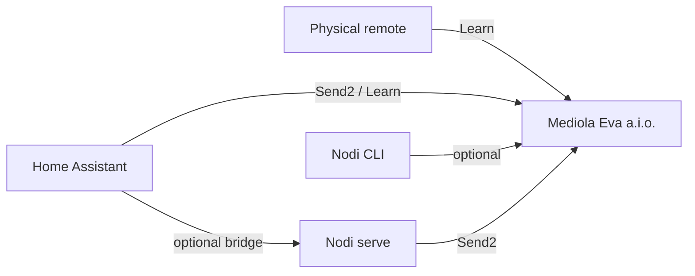

# Nodi

Nodi connects a **Mediola Eva a.i.o.** gateway to **Home Assistant** shutter (cover) control. It learns IR/RF remote codes, stores them per shutter direction, and exposes ready shutters as HA cover entities.

Two ways to use it:

1. **Home Assistant custom integration** (recommended) — HA talks directly to the Mediola gateway  
   → [`docs/home-assistant.md`](docs/home-assistant.md)
2. **Node.js CLI + optional HTTP bridge** — learn/send from a Mac or Linux host  
   → [`docs/cli.md`](docs/cli.md)

## Overview

Mediola gateways can learn and retransmit classic IR/RF shutter remotes. Nodi maps `up` / `down` / optional `stop` codes to named shutters and drives them from Home Assistant.

Schedules, scenes, and automations stay in Home Assistant. Nodi does not include a scheduler.

**Limitations:** IR/RF is assumed-state (no position feedback). Learn timeout and code formats vary by gateway firmware. The optional HTTP bridge needs a token if you bind it beyond loopback — see the CLI doc.

## Key features

- Learn IR/RF codes via Mediola `XC_FNC=Learn`
- Send codes via official `XC_FNC=Send2`
- Home Assistant config-flow integration with cover entities and learn/remove services
- Optional Node CLI for ping, learn, list, prepare, and confirmed send
- Optional local HTTP cover bridge + generated HA YAML

## How it works



Recommended path: install `custom_components/nodi`, add the integration, learn up+down in HA. Covers appear when both directions exist.

## Requirements

| Path | Requirements |
|---|---|
| HA integration | Home Assistant with access to `custom_components/`; Mediola on LAN |
| CLI / bridge | Node.js **22+**, npm; Mediola on LAN |

Optional: gateway username/password if auth is enabled on the device.

## Quick start (Home Assistant)

```bash
git clone https://github.com/Ole2669/nodi.git
cd nodi
./scripts/install-ha.sh user@ha-host /path/to/ha/config
```

Restart HA → **Settings → Devices & services → Add integration → Nodi** → Mediola host (e.g. `mediola.local`).

Then learn up + down via **Developer tools → Actions → `nodi.learn`**, and add a Cover card.

Full install options (HA OS, Docker, Supervised) and learn flow: [`docs/home-assistant.md`](docs/home-assistant.md).

CLI setup, env vars, commands, and HTTP bridge: [`docs/cli.md`](docs/cli.md).

## Project structure

```
src/                      Node CLI, store, Mediola client, optional HTTP bridge
custom_components/nodi/   Home Assistant integration
docs/                     HA and CLI guides
scripts/                  HA install helpers
data/                     Local codes.json (gitignored)
```

## Development

```bash
npm install
npm test
npm run typecheck
```

See [`CONTRIBUTING.md`](CONTRIBUTING.md) and [`docs/cli.md`](docs/cli.md) for details.

## Security

See [`SECURITY.md`](SECURITY.md). Treat learned codes and gateway credentials as secrets. Report vulnerabilities privately — do not open public issues that could expose credentials or enable unauthorized shutter control.

## License

MIT — see [LICENSE](LICENSE).

## Acknowledgements

- [Mediola](https://www.mediola.com/) Eva a.i.o. gateway HTTP API
- Community Learn documentation via [fhem-mediola](https://github.com/tobias-d-oe/fhem-mediola)
- [Home Assistant](https://www.home-assistant.io/) custom integration platform

## Further reading

- [`docs/home-assistant.md`](docs/home-assistant.md) — connect Nodi to HA
- [`docs/cli.md`](docs/cli.md) — CLI and HTTP bridge
- [`CONTRIBUTING.md`](CONTRIBUTING.md) · [`SECURITY.md`](SECURITY.md)
